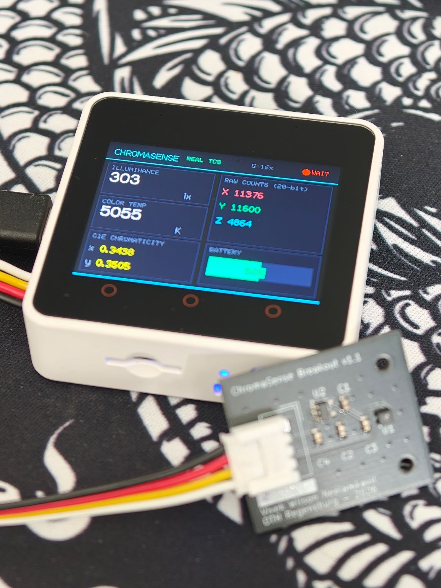
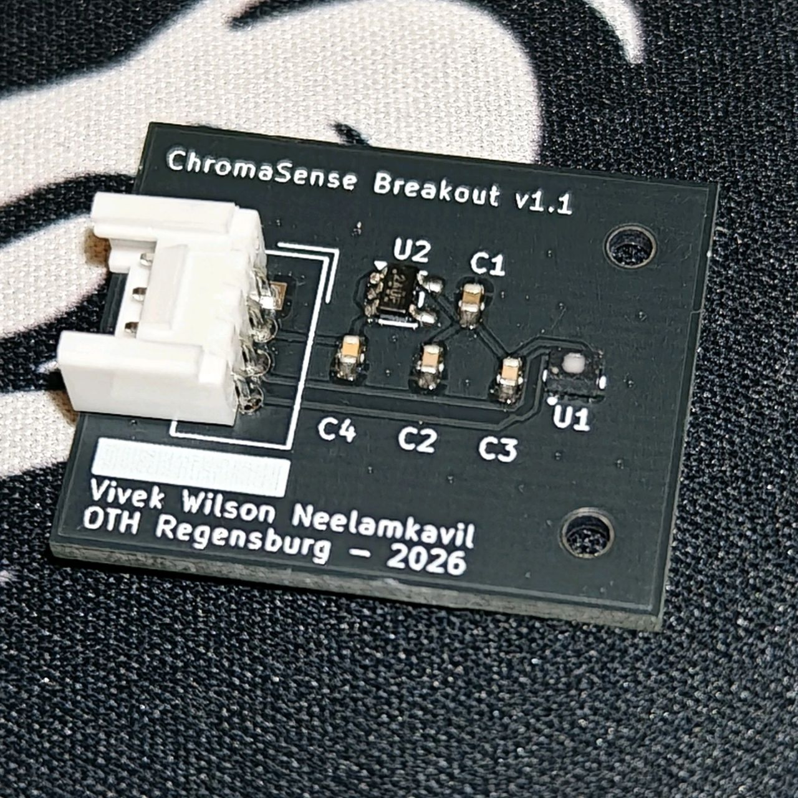
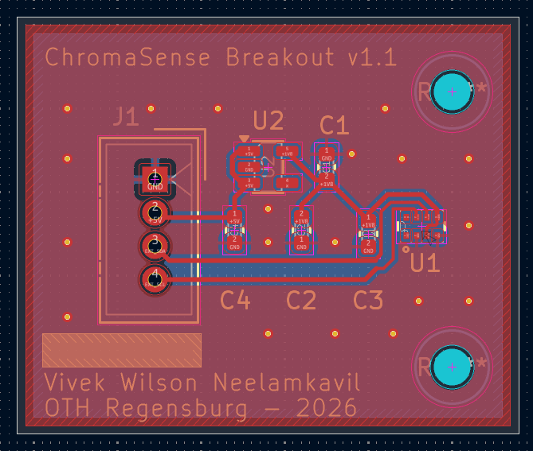
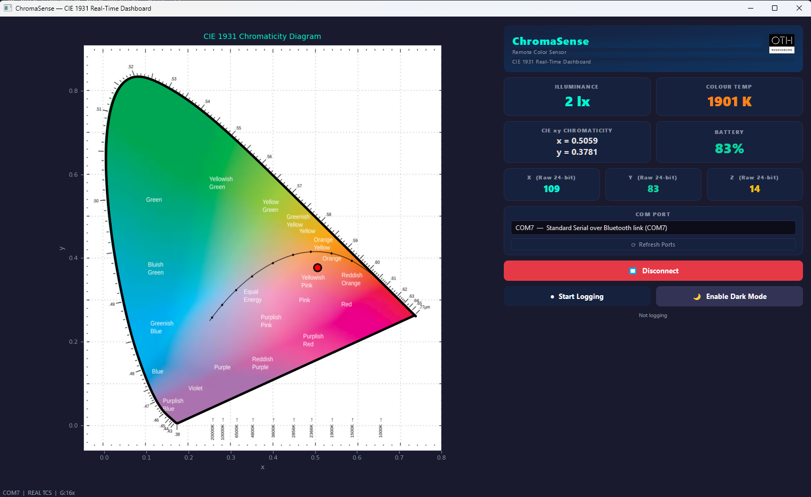

# ChromaSense

A wireless colorimeter I built for my M.Eng. project: a custom PCB around the TCS3530 colour sensor, an ESP32 that reads it and does the colour-science math, and a Python GUI that plots the result live on a CIE 1931 diagram. Parts cost works out to around €62 — commercial instruments that do roughly the same job run €1,500 to €6,000+.

If you only read one section, read [the three bugs](#three-bugs-that-didnt-look-like-bugs). That's where most of the actual engineering happened.



## What it does

Measures illuminance (lux), correlated colour temperature (CCT via McCamy's approximation), and CIE 1931 *xy* chromaticity, all live, streamed over Bluetooth to a desktop GUI at 10 Hz.

| | |
|---|---|
| Sensor | ams-OSRAM TCS35303-2M, 24-bit XYZ tristimulus |
| Board | 2-layer breakout I designed in KiCad, 25 × 30 mm — three built |
| MCU | M5Stack Core2 (ESP32), I²C @ 400 kHz |
| Link | Bluetooth SPP, JSON @ 10 Hz, commands back the other way |
| GUI | PyQt5, live CIE 1931 diagram |

## How well it works

CCT checked against what standard illuminants say each scene should read. These numbers come from the field-calibration stage and were re-checked on the same scenes after the factory calibration went in:

| Scene | ChromaSense | Expected | Error |
|---|---|---|---|
| Overcast sky | 7098 K | ~7500 K (D75) | ~5% |
| Direct sun | 5852 K | ~5500 K (D55) | ~6% |
| Light cloud | 5492 K | ~5500 K | <1% |
| Warm LED, indoors | 3342 K | 3000–3500 K | ~1–5% |

Chromaticity repeats to roughly Δxy ±0.002–0.005 on broadband light. A multi-point comparison from about 5 lux to 116,000 lux — crossing a 32× gain switch — held a constant ratio against the reference the whole way, which is the result I cared about most: it means the response is linear across the full range and only one scale factor is left to pin down.

## Why there's a custom PCB at all

The TCS3530 runs on 1.8 V and comes in a 2.5 × 1.8 mm LGA package — you can't just dead-bug it onto a 3.3 V dev board, and an LGA gives you no visible joints to inspect after reflow, so the footprint has to be right first time. The breakout carries the sensor, its own LDO, decoupling caps, and a Grove connector that plugs straight into the Core2's I²C port.

 

| Ref | Part | Why |
|-----|------|-----|
| U1 | TCS35303-2M | the sensor |
| U2 | AP2112K-1.8TRG1 | 1.8 V LDO for the sensor |
| C1–C4 | 4.7 µF / 1 µF 0402 MLCC | decoupling |
| J1 | Grove HY2.0-4P | I²C to the Core2 |

2-layer, DRC clean, fabbed at JLCPCB. I built three, and all three brought up and behaved identically — which turned out to matter later (see the Z-channel story).

## Firmware

PlatformIO, ESP32, M5Unified. The sensor driver (`firmware/lib/ChromaSense_TCS3530`) is mine, written from the datasheet and cross-checked against ams-OSRAM's reference driver. Every register in the header is cited to a datasheet page.

A few choices in there that weren't the default:

- **Hardware auto-gain is off.** The sensor can switch its own gain, but then the FIFO frame contents can change and the firmware can't be sure which gain a given reading was taken at. I moved gain switching into firmware instead: three steps (0.5×, 2×, 16×), stepping down above 800,000 counts and up below 3,000, with the gap between thresholds wider than the biggest gain step so it can't oscillate.
- **The first frame after a gain change gets thrown away.** It was integrated at the old gain. Using it gives one badly wrong reading at every transition, so the firmware waits one integration period and clears the FIFO first.
- **Only four channels go into the FIFO.** The sensor has eight; I disabled four of them, which fixes the frame at 12 bytes and removes a whole class of alignment bugs. Weeks later the factory calibration matrix arrived as 3×8 — and its last four columns were all zero for this sensor family. The frame I'd picked for safety was exactly what calibration needed.

**Calibration.** ams-OSRAM supplied factory calibration covering sixteen parts, one row per part, keyed by a 40-bit serial number burned into each sensor. So step one was a one-off firmware build to read five OTP registers, assemble the serial (557D0C06B8), and find the right row. Then three steps, in this order: normalise for integration time, normalise each channel's gain to a common 128× reference using the measured per-part correction, then a 3×4 matrix that maps raw counts to CIE XYZ.

The gain correction sounds fussy until you look at the numbers: on this part "2× gain" is actually 2.016× on Y and 1.992× on Z. Ignore that and you get a 1–2% channel-dependent error straight into chromaticity, and it changes with gain step, so you can't remove it later.

From XYZ it's arithmetic — x = X/(X+Y+Z), y = Y/(X+Y+Z), McCamy's cubic for CCT, calibrated Y for lux. McCamy is only valid near the blackbody curve, so anything outside 1500–20000 K comes back as 0 and the GUI shows a dash instead of a confident nonsense number.

The calibration numbers for this sensor are in `main.cpp` as plain constants — my supervisor's fine with that. What's not in here is ams-OSRAM's calibration file, their documentation, or their driver.

Also in there: an on-device dashboard, battery monitoring, and a dark mode that kills the backlight and status LED while the sensor keeps measuring — so the instrument isn't lighting up the thing it's measuring.

**How I built it up.** The whole signal chain — colour maths, display, Bluetooth, GUI — was built and tested against synthetic illuminants (D65, warm, cool) before a real sensor was connected. That paid off every time something broke later: with the maths already known good, a wrong reading had to be coming from the acquisition side.

## Three bugs that didn't look like bugs

None of these threw an error. In all three the system was doing exactly what its parts dictated, and the problem was an assumption I hadn't checked yet.

### 1. The driver that threw away a byte

The first library I used was a community one. Readings were plausible — they moved with the light, they saturated in bright sun — but colour accuracy was off, and I'd been blaming calibration. Reading ams-OSRAM's reference driver next to it showed why: the library read two bytes per channel, the sensor sends three. Every measurement was missing its bottom byte, a factor of 256 in resolution, with nothing to tell you.

I could have patched the read. I rewrote the driver instead, on the reasoning that a library that reads the wrong number of bytes has probably misunderstood the registers around it too. That was right — the rewrite turned up four more:

- **Everything read zero** during bring-up. The integration time was being written to the flicker-detection registers (0x8B/0x8C) instead of the ALS ones (0x87/0x88), so it stayed at its power-on default of ~355 µs instead of ~100 ms. The sensor was working perfectly and honestly reporting an absurdly short exposure.
- **Resolution still coarser than 24 bits**, even reading all three bytes correctly. `ALS_MSB_POSITION` has to be set explicitly, or the sensor truncates its own output before it ever reaches the FIFO. Same bug as the first one, one layer deeper — the first time the host was discarding data, this time the sensor never produced it. Having just found the first made the second recognisable.
- **Gain changes did nothing.** The library wrote gain to 0x50; the real gain registers are 0xC0–0xC3. The sensor sat at 2× whatever the firmware thought — which, it turned out, was also why my earlier lux calibration had been so hard to pin down.
- **Readings subtly wrong, health check passing anyway.** The oscillator has to be enabled and confirmed running before most registers work. But the ID register isn't clocked, so it answers regardless — and "read the ID, see if it matches" is exactly the check everyone uses to see if a sensor is alive.

### 2. The sky that read eight times too blue

Outdoors under overcast sky, Z (the blue channel) read about eight times higher than Y. For white light that ratio should be somewhere around 0.5–1.3.

My first guess was a PCB footprint error — sensor rotated 180°, putting the Z photodiode on the wrong side. But all three boards gave the same ratio (8.2, 8.6, 8.1), which ruled out anything to do with assembly. It was the sensor itself.

The TCS3530's Z photodiode is much more UV-sensitive than the CIE standard observer. Overcast sky is full of short-wavelength light scattered by the atmosphere, and the sensor sees it far more strongly than a human eye would. Under direct sun the same sensor read Z/Y ≈ 0.5. The measurement was real; my assumption that the sensor's raw response was close enough to the standard observer was what was wrong.

At the time I fixed it with two correction matrices — one for sky, one for sun — using the Z/Y ratio itself to pick between them, with hysteresis so sources near the boundary didn't flicker back and forth. That got CCT within about 5%. When the factory matrix arrived I deleted the whole scheme: its cross-channel terms correct the spectral mismatch directly, so one matrix handles both cases. Building the workaround taught me what the real fix needed to do; recognising it was redundant and removing it was the right call.

### 3. The backlight that wouldn't turn off

Dark mode needed the backlight off while the sensor kept running. The board library had documented calls for exactly that. I tried six approaches. Each failed differently: no effect, screen content blanked but light still on, a frozen screen, a register that read back as written but changed nothing — and one raw write that killed the backlight *and* the external I²C bus, so the sensor went down with it and the board needed a hard power cycle.

The failures weren't just unsuccessful, they were inconsistent with each other, which doesn't fit a software bug. It fits writing correct values to the wrong address space.

The clue was the colour of the status LED. The original Core2 has a green one and an AXP192 power-management chip. Mine has a blue one — that's the v1.1 revision, which uses an AXP2101, a different chip with a different register map. The library assumed AXP192 unconditionally. Every call I'd made was addressing the wrong chip's registers, which explained the whole pattern at once: some writes happened to land somewhere harmless, one landed on something important.

I checked that against M5Stack's own display-driver source and a long-running public issue before acting on it, then migrated the firmware to M5Unified, which detects the chip at boot. The calibration, driver, gain logic and telemetry format all carried over untouched — only the hardware layer underneath changed.

Six increasingly invasive register experiments, every one reasonable given the premise. The premise was what needed testing, and it took looking at an LED.

## The GUI



PyQt5 app: live chromaticity plot, telemetry panels for lux, CCT, raw 24-bit channel counts and battery, gain and saturation in the status bar, CSV logging.

**Putting live data on a picture.** The diagram background is a standard CIE 1931 reference image — it carries the wavelength ticks and colour-temperature labels people expect to read. But plotting a measured point on a raster image means knowing exactly where its pixels sit in CIE space. I picked three points on the spectral locus with known coordinates (380, 520 and 770 nm), fitted the pixel-to-CIE transform by least squares, and verified the origin independently with a reference mark.

To check the fit, I overlaid a spectral locus computed from the CIE colour-matching functions. It lined up on the top and right but drifted on the left flank around 480–510 nm, no matter how I adjusted the fit. The fit wasn't the problem — the image itself is about 12% wider per CIE unit horizontally than vertically (1420 vs 1263 px). Square in pixels, not square in CIE space. Stretching it to match would have distorted the baked-in labels, so the image stays as the display and the computed locus stays in the code as the way to re-verify it.

That computed locus had its own lesson: it looked faceted at the green apex. I assumed too few samples and went from 5 nm steps to 1 nm to 0.1 nm, and nothing changed — which was the useful result. `np.interp` is piecewise-linear; more samples just add more points along the same straight lines. `CubicSpline` fixed it by actually modelling the curve between data points.

Smaller things that mattered:

- **The device reports its own state.** Dark mode can be toggled from a button on the device or from the GUI. Instead of the GUI assuming what its last command did, every packet carries `"dark":0/1`, so the GUI always matches the device whichever side flipped it.
- **One bad packet can't crash it.** Early on I renamed a JSON field in firmware without updating the GUI and every packet crashed the dashboard. Now required keys are checked and malformed frames get dropped — and I treat the JSON format as an interface between two programs, not a detail.
- **Raw counts get logged**, not just the calibrated values, so if the calibration ever changes, old recordings can be reprocessed instead of re-measured.
- **10 Hz without stutter.** Qt re-parses a stylesheet every `setStyleSheet` call; with colour-graded labels at 10 Hz that adds up. Caching the last colour and skipping no-op updates fixed it. Bluetooth runs on its own `QThread` so a slow read never blocks the UI.

A typical packet:

```json
{"lux":417,"cct":4062,"x":0.3823,"y":0.3811,"X":112044,"Y":118631,"Z":80312,"gain":"2x","sat":0,"batt":87,"dark":0}
```

## Cost

| | € |
|---|---|
| TCS35303-2M | 8.50 |
| AP2112K-1.8TRG1 | 0.45 |
| Decoupling caps ×4 | 0.20 |
| Grove connector | 0.35 |
| PCB (JLCPCB, 5 off, shipped) | ≈3.00 |
| **Breakout total** | **≈12.50** |
| M5Stack Core2 | 50.00 |
| **Per unit** | **≈62.50** |

Full BOM with quantities and supplier links: [`BOM/ChromaSense_BOM_v2.xlsx`](BOM/ChromaSense_BOM_v2.xlsx).

For comparison, a [Sekonic C-800](https://galaxus.at/en/s1/product/sekonic-c-800-spectromaster-flash-unit-battery-flash-accessories-11488106) is €1,470, and a [Konica Minolta CL-200A](https://store.imatest.com/minolta-cl-200a-chroma-meter.html) is $6,500. To be clear, I'm not claiming this matches either — the C-800 is a real spectrometer with traceable calibration across the visible range, and this is one calibrated tristimulus sensor. What it does show is that you can get usable CIE coordinates for a small fraction of the cost if you're willing to build it yourself.

## What it doesn't do yet

- **Absolute lux isn't pinned down.** After calibration, Y is lux for the bare sensor. Anything placed over it — a housing, a window — will attenuate that, and the factor hasn't been measured yet. It's one number, `LUX_STACK_FACTOR` in `main.cpp`, and one afternoon with a reference meter once a housing exists. I didn't tune it to match a phone's light sensor in the meantime, because a phone isn't a reference.
- **Narrow-band sources fall outside the calibration.** Monitor primaries and saturated LEDs sit outside what the factory matrix was fitted for. That's inherent to tristimulus sensing — fixing it would need a spectrometer, not more tuning.
- **It's not traceable.** The calibration comes from ams-OSRAM's factory test equipment, but there's no DAkkS, NIST or PTB chain behind it. Good for relative and repeatable measurement, not for certification.
- **There's no enclosure.** I modelled a housing in Fusion 360 to the sensor's optical design constraints, but one connector position was never cross-checked against the PCB footprint, and with the deadline close I dropped it rather than print a part I hadn't verified. A wrong housing would have produced a worse, harder-to-spot error than no housing.
- **The calibration is for one sensor** (557D0C06B8). A different unit needs its own factory numbers from ams-OSRAM.

## Layout

```
chromasense/
├── hardware/     KiCad project, Gerbers, footprints, STEP model
├── firmware/     PlatformIO project
│   ├── src/main.cpp
│   └── lib/ChromaSense_TCS3530/   the driver
├── python-gui/   main_window.py, cie_widget.py, bt_worker.py
├── BOM/          full bill of materials
├── assets/
└── requirements.txt
```

## Running it

Firmware:
```bash
cd firmware
pio run --target upload
```
`platformio.ini` uploads on COM3 — change it to whatever your USB port is. If upload fails with `Invalid head of packet (0x7B)`, you're flashing the Bluetooth port by mistake: 0x7B is `{`, the start of the device's own JSON arriving where the bootloader expected a handshake.

Calibration for sensor 557D0C06B8 is already in `src/main.cpp`. Swap in your own sensor's numbers from ams-OSRAM if you're using a different unit.

GUI:
```bash
cd python-gui
pip install -r ../requirements.txt
python main_window.py
```
Pair the Core2 over Bluetooth, pick the right COM port in the dropdown, connect. Windows creates two Bluetooth COM ports when you pair; only one of them works.

---

M.Eng. Electrical and Microsystems Engineering, OTH Regensburg, Faculty ANK. Supervised by Prof. Johannes Wild. Graded 1.0.

**Vivek Wilson Neelamkavil** · [LinkedIn](#) · [CV](#)

TCS3530 references throughout are to the public datasheet (ams-OSRAM DS001080 v3-00). No ams-OSRAM documentation, software, or raw calibration files are included here.
